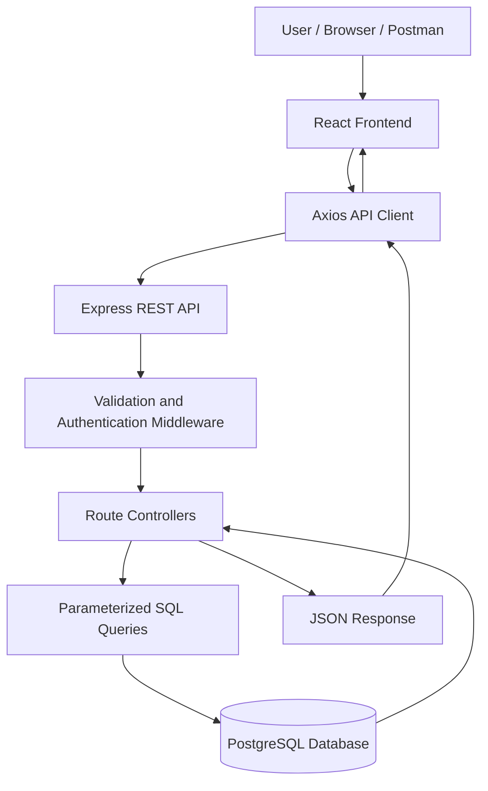
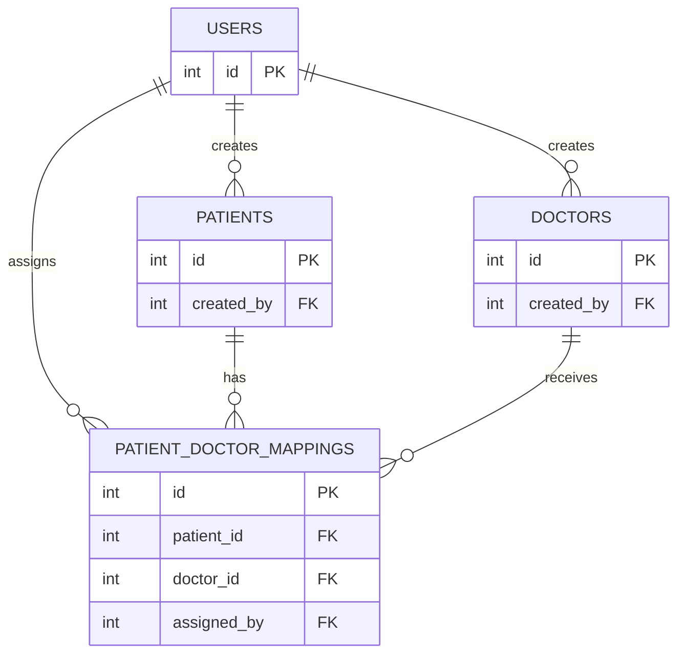

<div align="center">

# 🏥 HealthCare — Patient & Doctor Management System


**A full-stack healthcare management application with a React frontend and a Node.js, Express, and PostgreSQL backend.**

[](https://react.dev/)
[](https://vitejs.dev/)
[](https://tailwindcss.com/)
[](https://nodejs.org/)
[](https://expressjs.com/)
[](https://www.postgresql.org/)

[View Repository](https://github.com/Akshat9205/HealthCare) · [Report an Issue](https://github.com/Akshat9205/HealthCare/issues)

</div>

---

## 📌 Overview

**HealthCare** is a full-stack application for managing patient records, doctor information, and patient-doctor assignments. The backend exposes REST APIs built with Node.js and Express, while PostgreSQL stores relational data. The React frontend provides a dashboard for interacting with these APIs.

## ✨ Features

### Frontend
- Responsive dashboard layout with navigation.
- Login and registration screens.
- Patient management: create, view, update, and delete records.
- Doctor directory with creator-based modification permissions, if enforced by the backend.
- Patient-doctor assignment management.
- API loading, empty, success, and error states.
- Search, filters, charts, and animations where implemented in the frontend.

### Backend
- JWT-based authentication.
- Password hashing with `bcryptjs`.
- Patient record ownership checks.
- Doctor directory endpoints.
- Patient-doctor mapping endpoints.
- PostgreSQL connection pooling using `pg`.
- Parameterized SQL queries.
- Request validation with `express-validator`.
- Centralized error handling and security middleware.

> Feature descriptions should reflect the code that is actually present in the repository. Remove any item that is not implemented or tested.

## 🛠️ Tech Stack

| Area | Technology | Purpose |
|---|---|---|
| Frontend | React | Component-based user interface |
| Frontend tooling | Vite | Development server and build tool |
| Styling | Tailwind CSS | Responsive UI styling |
| Routing | React Router DOM, if configured | Client-side navigation |
| HTTP requests | Axios, if configured | API communication |
| Animation | Framer Motion, if configured | UI transitions |
| Icons | Lucide React, if configured | Interface icons |
| Charts | Recharts, if configured | Data visualization |
| Backend | Node.js + Express.js | REST API |
| Database | PostgreSQL | Relational data storage |
| Database driver | `pg` | Connection pool and parameterized SQL |
| Authentication | `jsonwebtoken` + `bcryptjs` | JWT and password hashing |
| Validation | `express-validator` | Request validation |

## 🏗️ System Architecture



## 📂 Project Structure

The backend folder name below follows the project structure previously described. If you have renamed it, update the paths here to match your repository.

```text
HealthCare/
├── healthcare-backend/
│   ├── src/
│   │   ├── config/
│   │   │   ├── db.js
│   │   │   └── env.js
│   │   ├── controllers/
│   │   ├── middleware/
│   │   │   ├── authenticate.js
│   │   │   ├── validate.js
│   │   │   ├── notFound.js
│   │   │   └── errorHandler.js
│   │   ├── routes/
│   │   ├── validators/
│   │   ├── utils/
│   │   ├── app.js
│   │   └── server.js
│   ├── sql/
│   │   └── schema.sql
│   ├── tests/
│   ├── .env.example
│   ├── .gitignore
│   └── package.json
├── frontend/
│   ├── src/
│   │   ├── api/
│   │   ├── components/
│   │   ├── context/
│   │   ├── pages/
│   │   ├── routes/
│   │   ├── App.jsx
│   │   ├── main.jsx
│   │   └── index.css
│   ├── .env.example
│   ├── package.json
│   └── vite.config.js
└── README.md
```

## 🔌 API Documentation

**Local backend URL:** `http://localhost:5001` (adjust to the `PORT` configured in your backend `.env`).

### System

| Method | Endpoint | Description | Access |
|---|---|---|---|
| GET | `/` | API root/welcome response, if configured | Public |
| GET | `/api/health` | Health check, if configured | Public |

### Authentication

| Method | Endpoint | Description | Access |
|---|---|---|---|
| POST | `/api/auth/register` | Register a user | Public |
| POST | `/api/auth/login` | Log in and receive a JWT | Public |
| GET | `/api/auth/me` | Get the authenticated user's profile | Bearer token |

### Patients

| Method | Endpoint | Description | Access |
|---|---|---|---|
| POST | `/api/patients` | Create a patient | Authenticated |
| GET | `/api/patients` | List the current user's patients | Authenticated |
| GET | `/api/patients/:id` | Get a patient by ID | Authenticated; owner only |
| PUT | `/api/patients/:id` | Update a patient | Authenticated; owner only |
| DELETE | `/api/patients/:id` | Delete a patient | Authenticated; owner only |

### Doctors

| Method | Endpoint | Description | Access |
|---|---|---|---|
| POST | `/api/doctors` | Create a doctor | Authenticated |
| GET | `/api/doctors` | List doctors | Authenticated |
| GET | `/api/doctors/:id` | Get doctor details | Authenticated |
| PUT | `/api/doctors/:id` | Update a doctor | Authenticated; confirm creator rule in code |
| DELETE | `/api/doctors/:id` | Delete a doctor | Authenticated; confirm creator rule in code |

### Patient–Doctor Mappings

| Method | Endpoint | Description | Access |
|---|---|---|---|
| POST | `/api/mappings` | Assign a doctor to a patient | Authenticated |
| GET | `/api/mappings` | List mappings accessible to the user | Authenticated |
| GET | `/api/mappings/:patient_id` | List mappings for a patient | Authenticated; verify ownership rules |
| DELETE | `/api/mappings/:id` | Remove a mapping | Authenticated; verify ownership rules |

### Authentication Header

For protected endpoints, send the JWT returned by the login endpoint:

```http
Authorization: Bearer YOUR_JWT_TOKEN
```

> Check the actual Express route files for trailing-slash behavior, request body fields, response formats, and access rules. This table documents the intended API surface and should be updated if your implementation differs.

## 🗃️ Database Design

The database schema is defined in `healthcare-backend/sql/schema.sql`.

The core entities are expected to include:

- **users** — registered user accounts.
- **patients** — patient records, with ownership recorded through `created_by` according to the described schema.
- **doctors** — doctor directory records.
- **patient_doctor_mappings** — patient-doctor relationships, including `assigned_by` if present in the schema.



*This is a conceptual diagram. Confirm the exact table names, foreign keys, data types, and constraints in `schema.sql` before treating it as a literal database specification.*

## ⚙️ Getting Started

### Prerequisites

- Node.js and npm.
- PostgreSQL running locally or at a reachable database host.
- Git.
- Postman (optional, for API testing).

### 1. Clone the repository

```bash
git clone https://github.com/Akshat9205/HealthCare.git
cd HealthCare
```

### 2. Configure and run the backend

```powershell
cd healthcare-backend
npm install
```

Create `.env` using `.env.example` as a reference. The backend uses individual database variables:

```env
PORT=5001
NODE_ENV=development
DB_HOST=localhost
DB_PORT=5432
DB_NAME=healthcare_db
DB_USER=postgres
DB_PASSWORD=your_postgres_password
DB_SSL=false
JWT_SECRET=replace_with_a_long_random_secret
JWT_EXPIRES_IN=24h
CORS_ORIGIN=http://localhost:5173
```

Use the exact variables supported by your `src/config/env.js`. Do not commit real credentials.

Create the database if it does not already exist:

```bash
psql -U postgres -c "CREATE DATABASE healthcare_db;"
```

Apply the schema from the backend directory:

```bash
psql -U postgres -d healthcare_db -f sql/schema.sql
```

Start the backend using the script defined in `package.json`, for example:

```bash
npm run dev
```

### 3. Configure and run the frontend

Open a **second terminal** at the repository root:

```powershell
cd frontend
npm install
```

Create `frontend/.env` based on `frontend/.env.example`. For example:

```env
VITE_API_BASE_URL=http://localhost:5001/api
```

Start Vite:

```bash
npm run dev
```

Vite commonly uses port `5173` by default. Use the URL printed in the terminal; the port may differ if `vite.config.js` overrides it.

## 🔒 Security Notes

- Hash passwords before storing them.
- Keep JWT signing secrets and database credentials on the backend only.
- Use parameterized SQL queries.
- Validate request bodies and route parameters.
- Enforce ownership checks on patient records and mappings.
- Restrict CORS to trusted frontend origins in production.
- Avoid returning internal database errors or sensitive information to clients.

## 🧪 Testing Checklist

- [ ] Register a user and log in.
- [ ] Verify `/api/auth/me` with a valid token.
- [ ] Confirm protected endpoints reject missing or invalid tokens.
- [ ] Test patient CRUD and ownership restrictions.
- [ ] Test doctor CRUD and creator permissions.
- [ ] Create, list, and delete patient-doctor mappings.
- [ ] Test invalid inputs and nonexistent IDs.
- [ ] Verify database health and error handling.
- [ ] Run the configured automated test suite, if available.
- [ ] Run a production frontend build.

## 👨‍💻 Developer

**Akshat Agarwal**  
B.Tech CSE · GLA University, Mathura · 2027 Batch

- GitHub: [@Akshat9205](https://github.com/Akshat9205)
- Project repository: [HealthCare](https://github.com/Akshat9205/HealthCare)

---

<div align="center">

**Built with ❤️ using React, Node.js, Express.js, and PostgreSQL.**


</div>
