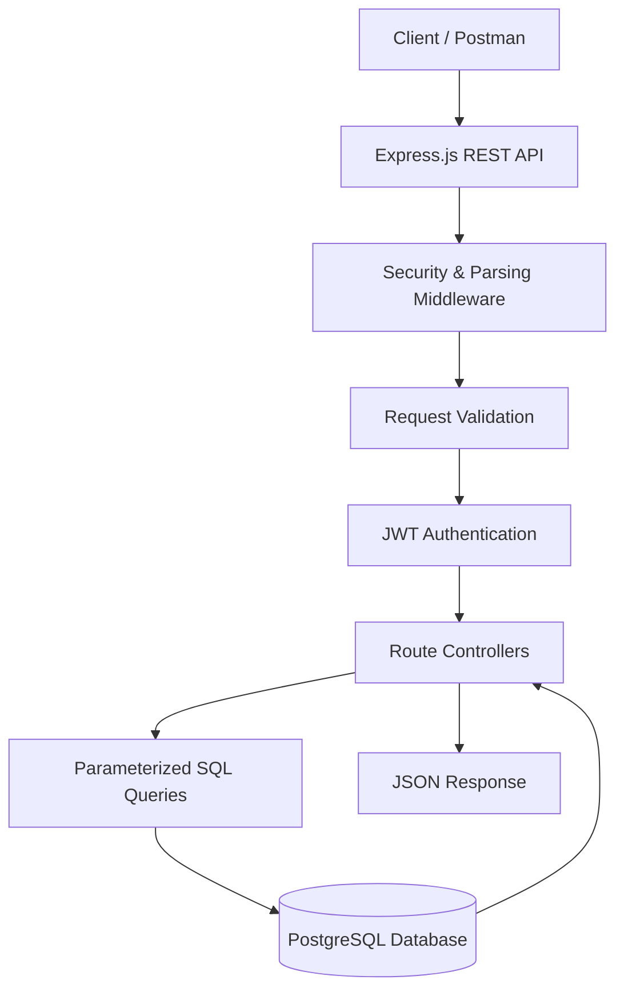
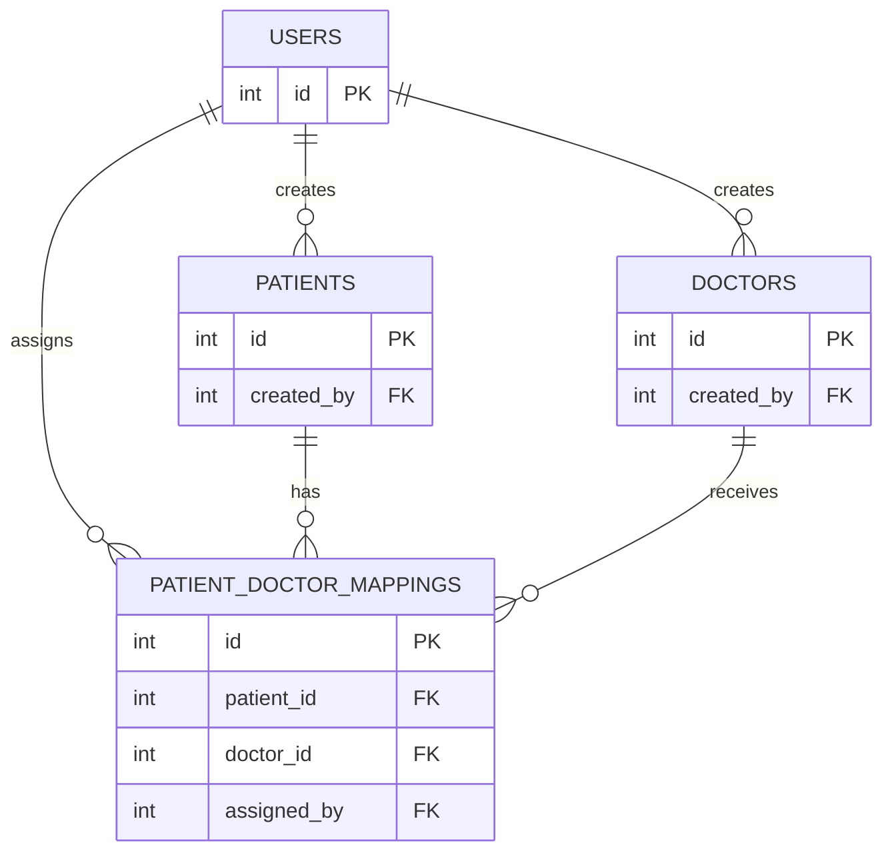

 <div align="center">

# 🏥 HealthCare — Patient & Doctor Management API


**A secure REST API for patient management, doctor directories, and patient-doctor assignments.**

[](https://github.com/Akshat9205/HealthCare)
[](https://nodejs.org/)
[](https://expressjs.com/)
[](https://www.postgresql.org/)
[](https://developer.mozilla.org/en-US/docs/Web/JavaScript)

</div>

---

## 📌 Overview

**HealthCare** is a backend application built to manage healthcare records through RESTful APIs. It provides JWT-based authentication, patient record management, a shared doctor directory, and patient-doctor assignment functionality.

The project demonstrates secure API development, relational database design, request validation, authorization, and structured error handling using Node.js, Express.js, and PostgreSQL.

## ✨ Key Features

- 🔐 **JWT Authentication:** User registration, login, and protected endpoints.
- 🔑 **Password Security:** Password hashing using `bcryptjs`.
- 👤 **Patient Management:** Create, retrieve, update, and delete patient records.
- 🩺 **Doctor Directory:** Manage and browse doctor information with creator-based write permissions.
- 🔗 **Patient–Doctor Assignments:** Link patients with doctors and manage existing mappings.
- 🛡️ **Authorization:** Restrict patient access to the owning user.
- 🗄️ **PostgreSQL:** Relational database with connection pooling using `pg`.
- ✅ **Input Validation:** Request validation and sanitization using `express-validator`.
- ⚠️ **Centralized Error Handling:** Consistent API error responses.
- 🔒 **Security Middleware:** Helmet, configurable CORS, and request-size limits.
- 🧪 **Automated Tests:** Authentication and resource API tests, where configured.

## 🛠️ Tech Stack

| Technology | Purpose |
|---|---|
| Node.js | JavaScript runtime |
| Express.js | REST API framework |
| PostgreSQL | Relational database |
| `pg` | Database connection pooling and SQL queries |
| `jsonwebtoken` | JWT authentication |
| `bcryptjs` | Password hashing |
| `express-validator` | Request validation |
| `dotenv` | Environment configuration |
| Helmet | HTTP security headers |
| CORS | Cross-origin request configuration |
| Morgan | HTTP request logging |
| Vitest / Supertest | Automated testing, if configured in the project |

## 🏗️ System Architecture



## 📂 Project Structure

```text
HealthCare/
├── healthcare-backend/
│   ├── src/
│   │   ├── config/
│   │   │   ├── db.js
│   │   │   └── env.js
│   │   ├── controllers/
│   │   │   ├── auth.controller.js
│   │   │   ├── patient.controller.js
│   │   │   ├── doctor.controller.js
│   │   │   └── mapping.controller.js
│   │   ├── routes/
│   │   │   ├── auth.routes.js
│   │   │   ├── patient.routes.js
│   │   │   ├── doctor.routes.js
│   │   │   └── mapping.routes.js
│   │   ├── middleware/
│   │   │   ├── authenticate.js
│   │   │   ├── validate.js
│   │   │   ├── notFound.js
│   │   │   └── errorHandler.js
│   │   ├── validators/
│   │   ├── utils/
│   │   ├── app.js
│   │   └── server.js
│   ├── sql/
│   │   └── schema.sql
│   ├── tests/
│   ├── .env.example
│   ├── .gitignore
│   └── package.json
├── .gitignore
└── README.md
```

*The tree shows the intended organization based on the project structure. Keep it synchronized with the actual files in your repository.*

## 🔌 API Documentation

### Base URL

```text
http://localhost:5001
```

The port depends on your `.env` configuration.

### 1. System Health

| Method | Endpoint | Description | Access |
|---|---|---|---|
| GET | `/` | API root or welcome response | Public |
| GET | `/api/health` | Check API and database health | Public |

### 2. Authentication

| Method | Endpoint | Description | Access |
|---|---|---|---|
| POST | `/api/auth/register` | Register a user | Public |
| POST | `/api/auth/login` | Authenticate and receive a JWT | Public |
| GET | `/api/auth/me` | Get the authenticated user's profile | Bearer token |

### 3. Patient Management

| Method | Endpoint | Description |
|---|---|---|
| POST | `/api/patients` | Create a patient |
| GET | `/api/patients` | List the current user's patients |
| GET | `/api/patients/:id` | Retrieve a patient by ID |
| PUT | `/api/patients/:id` | Update an owned patient |
| DELETE | `/api/patients/:id` | Delete an owned patient |

**Authorization:** Patient ownership is associated with the `created_by` column. Users should only be able to access their own patient records.

### 4. Doctor Management

| Method | Endpoint | Description |
|---|---|---|
| POST | `/api/doctors` | Create a doctor |
| GET | `/api/doctors` | List doctors |
| GET | `/api/doctors/:id` | Retrieve doctor details |
| PUT | `/api/doctors/:id` | Update a doctor |
| DELETE | `/api/doctors/:id` | Delete a doctor |

**Authorization:** The directory is shared for authenticated users to browse. Create, update, and delete permissions should follow the implemented creator-based authorization rules.

### 5. Patient–Doctor Mappings

| Method | Endpoint | Description |
|---|---|---|
| POST | `/api/mappings` | Assign a doctor to a patient |
| GET | `/api/mappings` | List accessible mappings |
| GET | `/api/mappings/:patient_id` | List mappings for a patient |
| DELETE | `/api/mappings/:id` | Remove a mapping |

*Use the exact paths, trailing-slash behavior, and authorization rules defined in your Express routes.*

### 🔑 Authentication Header

For protected requests, include the JWT returned by the login endpoint:

```http
Authorization: Bearer YOUR_JWT_TOKEN
```

Example request:

```bash
curl http://localhost:5001/api/auth/me \
  -H "Authorization: Bearer YOUR_JWT_TOKEN"
```

## 🗃️ Database Design

The PostgreSQL schema contains four core entities.

| Table | Purpose |
|---|---|
| `users` | Stores registered user and authentication information |
| `patients` | Stores patient information and the `created_by` owner reference |
| `doctors` | Stores doctor information and creator details |
| `patient_doctor_mappings` | Links patients and doctors, including `assigned_by` where defined |

### Entity Relationship Diagram



The diagram is a conceptual overview. Confirm actual data types, key names, constraints, and relationships against `healthcare-backend/sql/schema.sql`.

## ⚙️ Getting Started

### Prerequisites

Install the following before running the project:

- [Node.js](https://nodejs.org/) — compatible with the project's `package.json`.
- [PostgreSQL](https://www.postgresql.org/) — installed and running.
- [Git](https://git-scm.com/).
- [Postman](https://www.postman.com/) — optional, for API testing.

### 1. Clone the repository

```bash
git clone https://github.com/Akshat9205/HealthCare.git
cd HealthCare/healthcare-backend
```

### 2. Install dependencies

```bash
npm install
```

### 3. Configure environment variables

Create a `.env` file inside `healthcare-backend/`, using `.env.example` as the reference.

Example:

```env
PORT=5001
NODE_ENV=development

DB_HOST=localhost
DB_PORT=5432
DB_NAME=healthcare_db
DB_USER=postgres
DB_PASSWORD=your_postgres_password
DB_SSL=false

JWT_SECRET=replace_with_a_long_random_secret
JWT_EXPIRES_IN=24h

CORS_ORIGIN=*
```

**Important:**
- Use the exact variable names expected by your application.
- Replace the example password and JWT secret with your own values.
- Configure CORS to allow only trusted frontend origins in production.
- Never commit `.env` or real credentials to GitHub.

### 4. Create the PostgreSQL database

Create the database:

```bash
psql -U postgres -c "CREATE DATABASE healthcare_db;"
```

Apply the schema from the backend directory:

```bash
psql -U postgres -d healthcare_db -f sql/schema.sql
```

Alternatively, open `healthcare_db` in pgAdmin and execute the contents of `sql/schema.sql`.

If the database or schema already exists, inspect it before rerunning the setup commands.

### 5. Start the server

Development mode:

```bash
npm run dev
```

Production/start script:

```bash
npm start
```

These commands require corresponding scripts to be configured in `package.json`.

### 6. Verify the API

Open the following URL in your browser or API client if the health endpoint is implemented:

```text
http://localhost:5001/api/health
```

Then use Postman to test registration, login, patient operations, doctor operations, and mappings.

### 7. Run tests

```bash
npm test
```

This command requires a test script in `package.json`. Test results depend on the test configuration and database setup.

## 🔒 Security Considerations

- Hash passwords before storing them.
- Protect private routes with JWT authentication.
- Use parameterized SQL queries.
- Validate and sanitize incoming request data.
- Enforce patient ownership and mapping authorization.
- Keep database credentials and JWT secrets in environment variables.
- Use appropriate CORS settings and HTTP security headers.
- Return clear errors without exposing internal database details.

## 🧪 Testing Checklist

- [ ] User registration and login.
- [ ] Invalid credentials are rejected.
- [ ] Protected endpoints reject missing or invalid JWTs.
- [ ] Authenticated user profile retrieval.
- [ ] Patient CRUD and ownership restrictions.
- [ ] Doctor CRUD and creator-based permissions.
- [ ] Patient-doctor assignment creation.
- [ ] Mapping retrieval and deletion.
- [ ] Invalid request data and nonexistent IDs.
- [ ] Database connectivity and health endpoint.
- [ ] Error handling for failed database operations.

## 👨‍💻 Developer

**Akshat Agarwal**

B.Tech CSE | GLA University, Mathura | 2027 Batch

- GitHub: [@Akshat9205](https://github.com/Akshat9205)
- Project: [HealthCare — Patient & Doctor Management API](https://github.com/Akshat9205/HealthCare)

---

<div align="center">

**Built with Node.js, Express.js, and PostgreSQL.**


</div>
